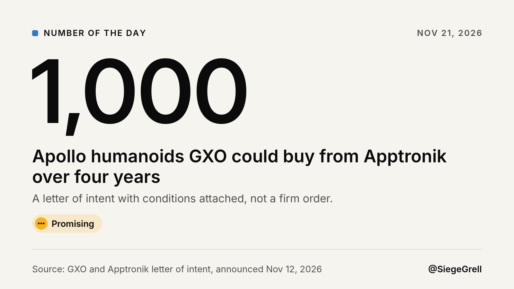

# siegegrell-media

Chart cards for posts on [@SiegeGrell](https://x.com/SiegeGrell), the humanoid-robot scorecard account. Each card is a 1600×900 PNG with a public link, so the scheduler (Postiz) can attach it to an X post.



## Make a card

```bash
python3 -I make_card.py spec.json            # or: ... | python3 -I make_card.py -
```

It writes `cards/<date>-<slug>.png` and prints one line of JSON:

```json
{"file": "cards/2026-11-21-gxo-apptronik-loi.png",
 "raw_url": "https://raw.githubusercontent.com/Jikjii/siegegrell-media/main/cards/2026-11-21-gxo-apptronik-loi.png",
 "alt": "Number of the day. 1,000: Apollo humanoids ...", "width": 1600, "height": 900, "bytes": 163117}
```

`raw_url` works once the file is pushed to `main`. `alt` is ready-made alt text for the post. If a card with the same date and slug exists, the new one gets a `-2` suffix; `--replace` overwrites instead.

If a field is too long to fit, the script exits with code 2 and names the field. Shorten it; text is never cut off.

## Spec

Fields every card needs:

| Field | Rule |
|---|---|
| `type` | `number`, `bars` or `scorecard` |
| `slug` | lowercase words joined by hyphens, 60 characters at most |
| `kicker` | the small header label, e.g. `Number of the day` (40 max) |
| `source` | the source in words, e.g. `GXO and Apptronik letter of intent, Nov 12, 2026` (160 max). `Source:` is added unless the text already starts with "Source" |
| `date` | optional, `YYYY-MM-DD`; defaults to today in New York |
| `theme` | optional: `light`, `dark` or `auto` (the default) |
| `nth` | with `auto`: the card's place among the day's cards in posting order, counting from 0. Light and dark alternate from card to card and from day to day |

### `number`: one figure that matters

| Field | Rule |
|---|---|
| `number` | the figure as it should read: `1,000`, `$59,950`, `96%` (14 max) |
| `label` | what the number counts (120 max, up to 2 lines) |
| `note` | optional context, e.g. what is conditional (170 max) |
| `verdict` | optional: `proven`, `promising`, `unproven` or `false` |

### `bars`: compare 2 to 8 values of the same kind

| Field | Rule |
|---|---|
| `title` | 90 max, up to 2 lines |
| `subtitle` | optional, e.g. the unit: `List price, US dollars` |
| `bars` | list of `{"label", "value", "display"}`; `value` is a number of 0 or more, `display` is how it prints (`$59,950`) |
| `highlight` | optional 0-based index of the bar the story is about; the others turn light blue |
| `note` | optional, 150 max |

### `scorecard`: the weekly verdicts

| Field | Rule |
|---|---|
| `title` | 90 max |
| `rows` | 1 to 6 items of `{"claim", "verdict"}`; claim 110 max; verdict `proven`, `promising`, `unproven` or `false` |

## Design

Inter (bundled in `fonts/`, SIL Open Font License) on a warm off-white card in light mode, or on a dark card in dark mode. Ink colors and the blue come from a colorblind-checked palette; verdicts always show a word and an icon, never color alone. Cards render at 2× and are scaled down, so edges stay smooth.
